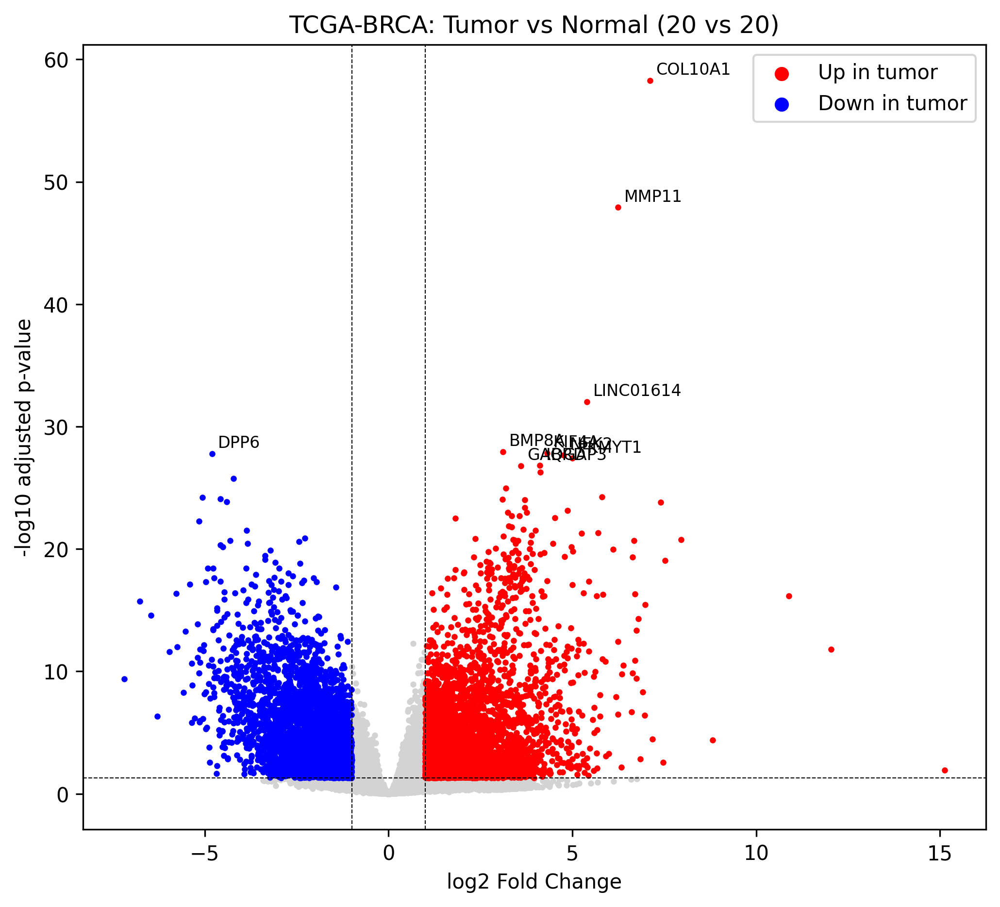

# Differential Gene Expression in Breast Cancer (TCGA-BRCA) using PyDESeq2

## Question
Which genes and biological pathways differ between primary breast tumors and normal breast tissue?

## Data
- **Source:** TCGA-BRCA, downloaded from the NCI Genomic Data Commons (GDC) API
- **Data type:** RNA-seq gene expression, STAR raw counts (unstranded column)
- **Samples:** 20 Primary Tumor vs 20 Solid Tissue Normal. These were the first 20 files per group returned by the GDC query, not a random sample.
- **Genes:** 60,660 initially, 44,127 after removing genes with fewer than 10 total counts

## Methods
1. Retrieved and merged per-sample count files in Python (`requests`, `pandas`)
2. Differential expression with **PyDESeq2** (design: `~condition`, contrast: tumor vs normal)
3. Significance thresholds: adjusted p < 0.05 and |log2 fold change| > 1
4. Mapped Ensembl IDs to gene symbols using the GDC annotation column
5. Pathway enrichment with **gseapy (Enrichr)** using GO Biological Process 2023 and KEGG 2021 Human, run separately on up- and down-regulated genes (padj < 0.01, |log2FC| > 2, top 300 genes per direction)

## Results
- **8,799 significant genes**: 4,767 up and 4,032 down in tumor
- Top up-regulated genes include COL10A1, MMP11, KIF4A, NEK2, PKMYT1 and IQGAP3. Top down-regulated: DPP6.

**Up in tumor:** strong enrichment of mitotic sister chromatid segregation, spindle assembly checkpoint signaling, and the KEGG cell cycle pathway (adjusted p < 1e-12), consistent with the high proliferation of tumor cells.

**Down in tumor:** only modest enrichment (adjusted p about 0.02-0.04) for terms such as PPAR signaling, muscle contraction and prostaglandin metabolism. These should be interpreted cautiously.

## Limitations
- Unpaired comparison: tumor and normal samples come from different patients
- Small subset (20 vs 20) of roughly 1,100 tumor and 110 normal samples available in TCGA-BRCA
- Samples were not chosen randomly
- No adjustment for tumor subtype (ER+, HER2+, triple-negative) or batch effects
- Enrichr tests against its own gene universe, not only the genes measured here

## Files
| File | Description |
|---|---|
| `BRCA_DESeq2.ipynb` | Full analysis notebook ([open in Colab](https://colab.research.google.com/drive/1en4n6TRPsKwrx_oRftGYvnTC15APIQHT?usp=sharing)) |
| `deseq2_results.csv` | DESeq2 results for all tested genes |
| `enrichment_up.csv` / `enrichment_down.csv` | Top enriched pathways |
| `volcano_labeled.png` | Volcano plot |

## Tools
Python, PyDESeq2, pandas, NumPy, matplotlib, gseapy, Google Colab

## Data source
TCGA-BRCA via the NCI GDC (https://portal.gdc.cancer.gov)
